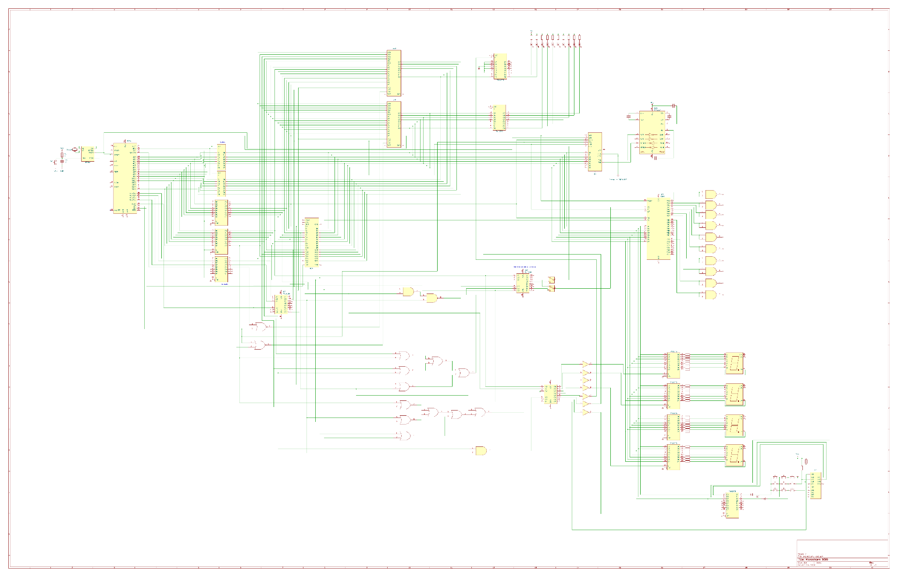

# 8086 Microprocessor-Based System – KiCad Schematic

University project for the *Microprocessor Design* course at Politehnica University Timișoara (2025–2026).
The goal was to design the complete schematic of a microcomputer system built around the Intel 8086, in minimum mode.

## System overview

- **CPU:** Intel 8086 (minimum mode), with an 8284A clock generator (15 MHz crystal, 5 MHz CPU clock)
- **Address bus:** demultiplexed with 3× 74LS373 latches, driven by ALE
- **Data bus:** 16-bit, buffered with 2× 74LS245 transceivers (controlled by DT/~R and ~DEN)
- **Memory:** 64 KB EPROM (27C2048) and SRAM (2× 62256) organized in even/odd banks, selected with A0 and ~BHE
- **Address decoding:** 74LS138 decoders and logic gates for memory and I/O chip select signals
- **Serial interface:** 8251 USART with a MAX232 RS-232 level shifter, 9600 baud
- **Parallel interface:** 8255 PPI
- **Switch-selectable I/O addresses:** the serial and parallel interfaces can be mapped to two address ranges each, using switches S1 and S2
- **Peripherals:** 3×3 keypad (74LS373 + 74LS244), 10 LEDs and a 4-digit 7-segment display

I also created custom schematic symbols for components, based on their datasheets.

## Schematic sections

| Section | Image |
|---|---|
| CPU, clock, address latches and data buffers | [1_unitatea_centrala.png](images/1_unitatea_centrala.png) |
| Memory connections | [2_memorii.png](images/2_memorii.png) |
| Serial and parallel interfaces | [3_interfata_seriala_paralela.png](images/3_interfata_seriala_paralela.png) |
| I/O port decoding | [4_decodificare_porturi.png](images/4_decodificare_porturi.png) |
| Keypad | [5_minitastatura.png](images/5_minitastatura.png) |
| LEDs | [6_leduri.png](images/6_leduri.png) |
| 7-segment display | [7_afisaj_7_segmente.png](images/7_afisaj_7_segmente.png) |

## Tools

KiCad 9.0
